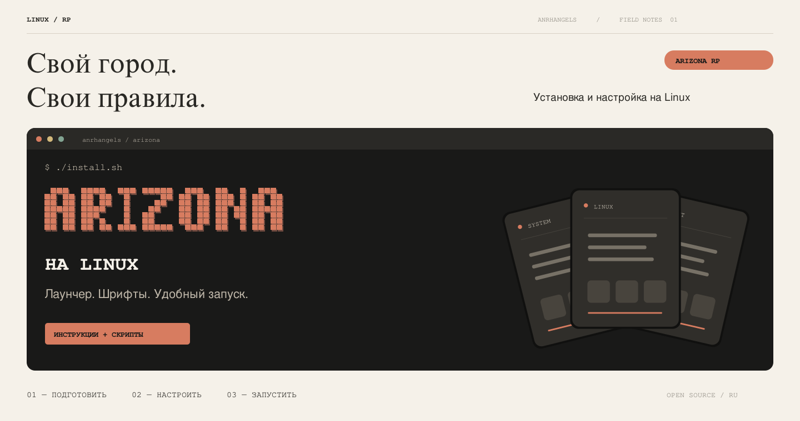
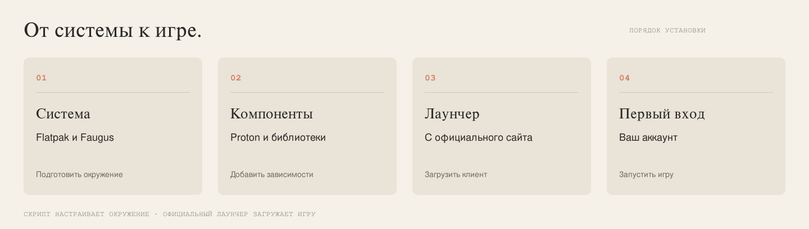
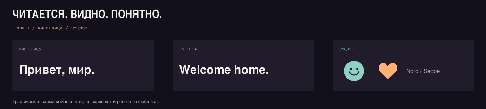

<p align="center"></p>

<p align="center">
  <a href="#установка"><b>Установить игру</b></a> ·
  <a href="docs/troubleshooting.md">Нужна помощь</a> ·
  <a href="docs/advanced.md">Для опытных пользователей</a> ·
  <a href="docs/README.md">Вся документация</a>
</p>

```text
LINUX RP SERIES / 01
ARIZONA ROLE PLAY НА LINUX
Установка · запуск · русский текст · эмодзи
```

**Хотите играть в Arizona RP на Linux? Начните здесь.** Скачайте эту папку и запустите установщик. Он подготовит нужные программы, скачает официальный лаунчер Arizona, настроит шрифты и добавит ярлык игры в меню приложений.

Знать Wine и Proton заранее не нужно. После настройки вам останется открыть лаунчер, скачать в нём игру и войти в свой аккаунт.

> **Что уже проверено:** запуск игры на Arch Linux, управление на английской раскладке, русский чат, кириллица голосового интерфейса и эмодзи. Новый установщик прошёл автоматические проверки, но полный путь установки с нуля ещё предстоит проверить в игре. На других дистрибутивах подготовка предусмотрена, успешный игровой запуск пока не подтверждён. [Подробнее о проверках →](docs/compatibility.md)

<a id="установка"></a>

## 01 / Установка за пять шагов

### 1. Убедитесь, что ваш компьютер подходит

Нужны Linux на обычном 64-битном ПК или ноутбуке, интернет, установленный драйвер видеокарты с поддержкой Vulkan и место для игры. Подготовлены варианты для **Arch/CachyOS/Manjaro, Debian/Ubuntu/Mint, Fedora и openSUSE Tumbleweed**.

Если у вас SteamOS, Fedora Silverblue/Kinoite, NixOS или другая система с особым способом установки программ, сначала откройте [инструкцию для дистрибутивов](docs/distributions.md). ARM-компьютеры этой сборкой не поддерживаются.

### 2. Скачайте и распакуйте папку

**[Скачать ZIP-архив](https://github.com/anrhangels/linux-arizona-rp/archive/refs/heads/main.zip)**

Откройте скачанный архив и выберите «Извлечь» или «Распаковать». Затем откройте полученную папку. Внутри должны быть файл **`install.sh`** и папки `scripts`, `docs`, `assets`.

### 3. Откройте терминал в этой папке

В файловом менеджере нажмите правой кнопкой мыши на свободное место внутри папки и выберите **«Открыть в терминале»**. Название пункта может немного отличаться.

Если такого пункта нет, воспользуйтесь [инструкцией с примером пути](docs/installation.md#как-открыть-терминал-в-нужной-папке).

### 4. Запустите установку

Скопируйте команду целиком, вставьте в терминал и нажмите Enter:

```bash
bash install.sh
```

Установщик покажет, что собирается сделать. Для продолжения введите **`y`** и нажмите Enter. При запросе пароля введите пароль вашего пользователя Linux. **При вводе пароль может совсем не отображаться — это нормально.**

Дождитесь сообщения **«Готово»**. Программы и компоненты скачиваются из интернета, поэтому первая установка может занять время. Если после установки лаунчер открылся сам, закройте его: скрипт должен закончить настройку.

### 5. Откройте игру

Найдите **Arizona RP** в меню приложений. Или выполните в терминале:

```bash
~/.local/bin/arizona
```

В официальном лаунчере выберите **Arizona RP**, скачайте игровые файлы, выберите сервер и войдите в аккаунт. Во время игры используйте английскую раскладку для управления персонажем.

**После настройки запускать `install.sh` каждый раз не нужно.** Пользуйтесь ярлыком или командой выше.

<p align="center"></p>

## 02 / Что установится автоматически

| Вам нужно… | Установщик сделает это сам |
| :--- | :--- |
| Подготовить Linux | Установит Flatpak и остальные необходимые инструменты через пакетный менеджер вашей системы |
| Запустить Windows-игру | Установит Faugus и подготовит Proton и UMU — компоненты для запуска игры на Linux |
| Получить лаунчер | Скачает актуальный официальный установщик Arizona и запустит его |
| Настроить текст | Добавит свободные шрифты для русского текста и эмодзи |
| Удобно запускать игру | Создаст команду запуска, ярлык и настроит необязательную панель FPS |
| Найти причину ошибки | Сохранит журнал запуска и резервные копии изменяемых файлов |

Самостоятельно устанавливать системный Wine или искать библиотеки по разным сайтам не требуется. Драйвер видеокарты должен быть установлен заранее. Скачивание самой игры и вход в аккаунт выполняются в официальном лаунчере.

## 03 / Русский текст и эмодзи

<p align="center"></p>

Установщик добавляет шрифты автоматически. В нашей игровой установке русский текст и эмодзи отображались, в том числе появилась кириллица в голосовом интерфейсе.

Если у вас всё ещё видны квадраты, вопросы или ошибки шрифтов, откройте [пошаговую помощь со шрифтами](docs/fonts.md). Там же описано, как подключить оригинальные Segoe из своей Windows. Для обычной установки заранее искать эти файлы не нужно.

## 04 / Если что-то не получилось

| Что вы видите | Что сделать |
| :--- | :--- |
| `install.sh: No such file or directory` | Терминал открыт не в папке проекта. [Как перейти в нужную папку →](docs/installation.md#как-открыть-терминал-в-нужной-папке) |
| Скрипт просит закрыть Faugus или Wine | Закройте лаунчер и игры, затем повторите команду |
| Загрузка прервалась или появилась ошибка 403 | [Помощь с загрузкой →](docs/troubleshooting.md#загрузка) |
| Непонятные символы или ошибка шрифта | [Помощь со шрифтами →](docs/fonts.md) |
| Персонаж не двигается на русской раскладке | Переключите раскладку на английскую |
| Лаунчер открылся, а дальше непонятно | [Первый вход в игру →](docs/installation.md#первый-вход) |
| Другая ошибка | [Поиск по симптомам →](docs/troubleshooting.md) |

Панель FPS: **F10** переключает режимы, **F12** скрывает или показывает её. FPS — количество кадров в секунду. Установщик не задаёт ограничение FPS.

## 05 / Если вы уже знакомы с Linux

Установка через Git:

```bash
git clone https://github.com/anrhangels/linux-arizona-rp.git
cd linux-arizona-rp
bash install.sh --plan
bash install.sh
```

`--plan` показывает действия без изменений и загрузок. Параметры установки, работа с готовым префиксом, пути XDG, журналы и восстановление описаны в [техническом руководстве](docs/advanced.md).

| Руководство | Что внутри |
| :--- | :--- |
| [Подробная установка](docs/installation.md) | ZIP, терминал, первый вход и повторный запуск |
| [Справка для опытных пользователей](docs/advanced.md) | Все параметры, префиксы, пути, проверка, откат |
| [Дистрибутивы](docs/distributions.md) | Пакетные менеджеры, зависимости, Vulkan и особые системы |
| [Словарь](docs/glossary.md) | Что такое префикс, Proton, Flatpak и другие термины |
| [Результаты проверок](docs/compatibility.md) | Где игра запускалась и какие ограничения остались |

[Все инструкции](docs/README.md) · [Официальные источники](docs/sources.md) · [Сообщить о проблеме](https://github.com/anrhangels/linux-arizona-rp/issues/new/choose)

<p align="center"><sub>LINUX RP SERIES / 01 · Независимая инструкция сообщества · Код и собственные иллюстрации — MIT</sub></p>
